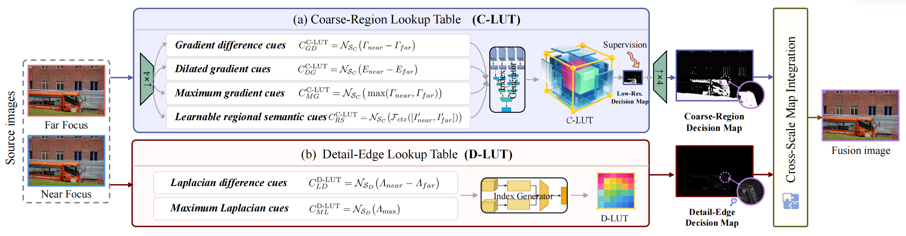

<h1 align="center">[ECCV 2026] UHD-MFF</h1>
<p align="center">
  <em> Shattering Barriers in Multi-Focus Ultra-High-Definition Image Fusion via Learnable Lookup Tables</em>
</p>


<p align="center">
  
</p>


---

## ⚙️ Environment

```
conda create -n lutfuse python=3.8
conda activate lutfuse
```

```
conda install pytorch==2.0.0 torchvision==0.15.0 pytorch-cuda=11.8 -c pytorch -c nvidia
pip install -r requirements.txt
```

## 📂 Dataset

Figure 2 illustrates our synthetic data generation pipeline. In addition, we also collected a set of real-world data.

The datasets are available for download: [UHD-MFF-Real](https://drive.google.com/drive/folders/1dinWJjwt21YyxdFFwg8nKtPJIwjudMAa) and [UHD-MFF-Syn](https://drive.google.com/drive/folders/1vcs_UAeagjR2Er4N0OXtXK-1BOBRTXws).

## 💾 Checkpoints

We provide our **pretrained checkpoints** directly in this repository for convenience.  
You can find them under [`./ckpts`](./ckpts).

- **Fusion LUT weights:** `ckpts/lut1.npy`   `ckpts/lut2.npy`
- **Context generator weights:** `ckpts/generator_context.pth`

## 🧪 Test

```
CUDA_VISIBLE_DEVICES=0 python test_mff.py
```

## 🚀 Train

```
CUDA_VISIBLE_DEVICES=0 python train_mff.py
CUDA_VISIBLE_DEVICES=0 python train_mff_s2.py
```

## 📖 Citation

If you find our work or dataset useful for your research, please cite our paper.

```bibtex
@inproceedings{zhang2026uhd,
  title={UHD-MFF: Shattering Barriers in Multi-focus Ultra-High-Definition Image Fusion via Learnable Lookup Tables},
  author={Zhang, Yibing and Yi, Xunpeng and Yan, Qinglong and Wang, Yeda and Xu, Han and Ma, Jiayi},
  booktitle={European Conference on Computer Vision},
  pages={294--311},
  year={2026},
  organization={Springer}
}
```


If you have any questions, please send an email to zhangyibing@whu.edu.cn
